<picture>
  <source media="(prefers-reduced-motion: reduce)" srcset="./assets/hero-static.svg">
  
</picture>

### 这里是， ZMS-PNG 

**产品、技术、架构。**

把想法一点点做成可以用的东西，目前在学习架构、部署与排障。持续产品推进、顺便分享作为开源项目。

<picture>
  <source media="(prefers-reduced-motion: reduce)" srcset="./assets/divider-static.svg">
  
</picture>

### 两个可以逛逛的项目

**[Vaultide · 知洄 ↗](https://github.com/ZMS-PNG/Vaultide)**

一个学习工作台，把来源证据、互动学习、练习和 Obsidian 笔记连起来。基于 [OpenMAIC](https://github.com/THU-MAIC/OpenMAIC) 演进，已有公开预览版。

[打开 v0.1.0 公开预览 →](https://github.com/ZMS-PNG/Vaultide/releases/tag/v0.1.0-public-preview)

**[MAPES ↗](https://github.com/ZMS-PNG/yuns-)**

一个多 Agent 角色表现评测原型。通过 Python CLI、mock judge 和六维评分，把评测过程整理成报告。

### 还在折腾些什么

- **教学训练** — 把岗位需求、课程、练习和评价串起来。
- **农业多智能体** — 梳理任务交接和人员确认流程。
- **创作工具** — 脚本、分镜、素材，以及图片和视频生成的使用流程。
- **跌倒识别原型** — 从人体关键点和连续动作判断开始做。

边做边学、边学边做...小小进步而已
