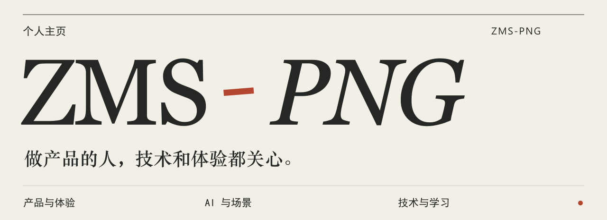

  <picture>
    <source media="(max-width: 640px)" srcset="./images/profile-header-mobile.svg">
    
  </picture>

我在做一些和 **AI 学习、知识整理、Agent 协作**有关的工具。

习惯从具体问题开始，读懂已有材料，做出可以使用的版本，再沿实际流程验证和改进。希望每次学习都能留下可以回看、复用和继续探索的记录。

## 最近在做

### Vaultide · 知洄

**开源学习工作台 · Public Preview**

我想把读资料、理解、练习和回到笔记里复习接起来，让下一次学习能从上一次的积累开始。围绕这个想法，Vaultide 将 GitHub 项目、论文、技术文章和 Obsidian 笔记组织为带来源证据的互动学习路径。

| 环节 | 在 Vaultide 里的实践 |
| --- | --- |
| 选材与理解 | 审查外部资料或笔记来源，组织带引用证据的互动课堂 |
| 练习与复习 | 通过主动练习、阶段查点和复习任务记录学习进度 |
| 积累与连接 | 经预览与确认后写回 Obsidian，逐步归纳知识关系 |

基于 OpenMAIC 演进，重点扩展长期学习与知识沉淀工作流。

[项目仓库](https://github.com/ZMS-PNG/Vaultide) · [公开预览与演示](https://github.com/ZMS-PNG/Vaultide/releases/tag/v0.1.0-public-preview) · [上游 OpenMAIC](https://github.com/THU-MAIC/OpenMAIC)

### MAPES · 多 Agent 个性化表现评测

**评测原型 · MVP**

我也在尝试把 Agent 在互动场景中的表现评价得更具体。MAPES 从角色一致性、个性表达、场景感知、情感共鸣、多 Agent 协作，以及幻觉与安全控制六个维度组织评分与反馈。

原型包含 Python CLI、mock judge 与评分报告流程。ERNIE Judge 和 PaddleOCR 处于适配器预留阶段。

[项目仓库](https://github.com/ZMS-PNG/yuns-)

## 做项目时常用

| 方向 | 技术与工具 |
| --- | --- |
| Web 应用 | TypeScript · React · Next.js |
| 评测脚本 | Python · CLI · Rubric 评分 |
| 知识管理 | PostgreSQL · Neon · Obsidian · Markdown |
| 测试开发 | Vitest · Playwright · Git · GitHub |

## 还在继续探索

AI 编程助手与可复用 Skills、n8n 工作流编排，以及多模态工具在学习中的应用。这里会逐步记录我实际做过、能够展示的尝试。

---

欢迎在相关项目的 Issues 中交流 AI 学习工具、Obsidian 工作流或 Agent 评测的实践。
