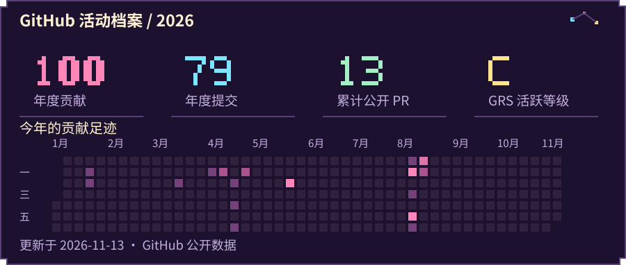
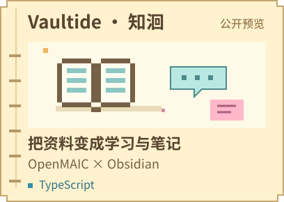
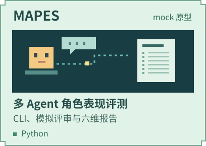
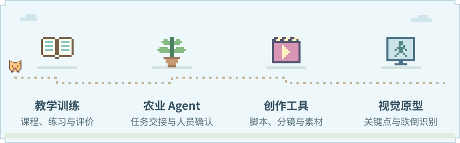

<picture>
  <source media="(prefers-reduced-motion: reduce)" srcset="./assets/hero-static.svg">
  
</picture>

### 这里是， ZMS-PNG 

**产品、技术、架构。**

把想法一点点做成可以用的东西，目前在学习架构、部署与排障。持续产品推进、顺便分享作为开源项目。

<picture>
  <source media="(prefers-reduced-motion: reduce)" srcset="./assets/divider-static.svg">
  
</picture>

<a href="https://github.com/ZMS-PNG?tab=overview">
  <picture>
    <source media="(max-width: 640px)" srcset="./assets/github-stats-mobile.svg">
    
  </picture>
</a>

贡献和提交按当年统计，PR 按累计统计。评级采用 GitHub Readme Stats 算法。[数据](./assets/github-stats.json) · [评级算法](https://github.com/anuraghazra/github-readme-stats/blob/master/src/calculateRank.js)

### 正在建造

  
  

Vaultide · 知洄已有可查看的公开版本。[打开预览](https://github.com/ZMS-PNG/Vaultide/releases/tag/v0.1.0-public-preview) · [上游 OpenMAIC](https://github.com/THU-MAIC/OpenMAIC)

MAPES 从 CLI、模拟评审与六维评分开始探索角色评测。[查看原型](https://github.com/ZMS-PNG/yuns-)

### 工作台上的支线

<picture>
  <source media="(max-width: 640px)" srcset="./assets/practice-mobile.svg">
  
</picture>
