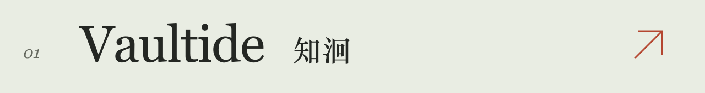
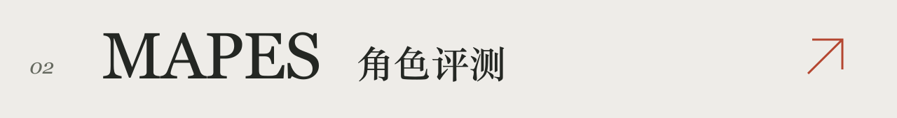

  <picture>
    <source media="(max-width: 640px)" srcset="./images/profile-header-mobile.svg">
    
  </picture>

我在做产品，也在和 AI 一起写代码、改界面、解决问题。

最近常想的是，一个新用户从哪里开始，怎样顺利完成第一次使用，为什么愿意再回来。画原型、改文案、调整按钮的位置，也把这些想法落实到具体的流程里。

### 最近的题目

- **教学训练** — 把岗位需求、课程、练习和评价串起来。
- **行业 Agent** — 梳理农业多智能体的任务交接和人员确认流程。
- **创作工具** — 脚本、分镜、素材，以及图片和视频生成的使用流程。
- **视觉原型** — 从人体关键点和连续动作判断开始做跌倒识别。

### 公开作品

把读资料、互动课堂、练习和 Obsidian 笔记接起来的学习工具。基于 OpenMAIC 演进，目前是公开预览版。

[预览与演示 ↗](https://github.com/ZMS-PNG/Vaultide/releases/tag/v0.1.0-public-preview) · [上游 OpenMAIC](https://github.com/THU-MAIC/OpenMAIC)

尝试更具体地评价 Agent 在互动场景中的角色表现。当前原型包含 Python CLI、mock judge 和六维评分报告流程。

[查看原型 ↗](https://github.com/ZMS-PNG/yuns-)

### 还在学

架构、部署和故障定位。希望自己能逐渐看懂并接手产品背后的系统，出了问题时，知道它卡在哪一步，该从哪里查起。

有具体问题，欢迎在项目里聊。
